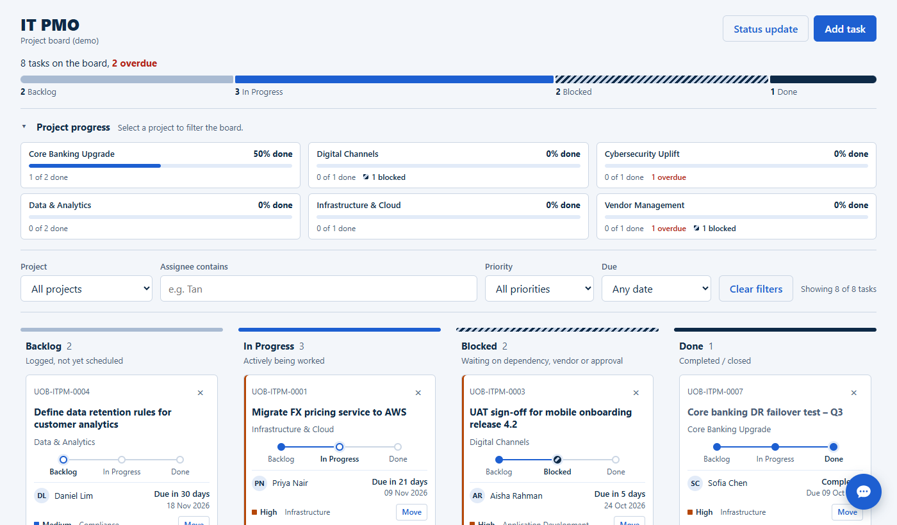

# IT PMO Project Board (Demo)


A single-file Kanban board for an IT project management office (PMO), built as a demo and training tool for a fictitious bank. Plain HTML, CSS and JavaScript: no framework, no build step, no npm.

**Live demo:** https://zhangranclaude-cloud.github.io/it-pmo-board-v2/

Version 2 redesigns the board around a status flow bar, relative due dates ("Overdue by 3 days") and quieter cards. The original version lives at https://zhangranclaude-cloud.github.io/uob-claudclass/.



## Features

- Four columns: Backlog, In Progress, Blocked, Done, with live counts and a header flow bar sized by task count.
- Project progress panel: one bar per workstream with % done and overdue/blocked counts. Select a project to filter the board, select it again to show all. Collapsed by default on phones.
- Each card shows a stage stepper (Backlog → In Progress → Done); a blocked task sits on the middle step, hatched and labelled Blocked.
- Cards show ID, title, project, assignee, priority, category and a relative due date ("Due in 5 days", "Overdue by 3 days").
- Drag and drop between columns, or a keyboard "Move" control.
- Add Task form with inline validation and optimistic UI. IDs follow `UOB-ITPM-####`.
- Filters by project, assignee, priority and due date (overdue, next 7 days).
- Status update: one click drafts a plain-text weekly summary (overdue, blocked, due this week, completed) to copy into an email or chat.
- Add Task errors are shown inline and in a focused summary that links to each field; fields are checked as you leave them.
- Help chat button (bottom right): opens a help panel, says "How can I help you?" aloud using the browser's speech synthesis, and links to WhatsApp (+65 1234 5678) with a pre-filled message. Change `WHATSAPP_NUMBER` near the top of the script to use another number.
- Follows the system light or dark mode.
- A Content-Security-Policy meta tag limits the page to inline code and one network destination, FormSubmit.
- Inline delete confirmation (no browser dialogs).
- Optional email notification for each new task through [FormSubmit](https://formsubmit.co).

## Install

There is nothing to install. No dependencies, no build.

```bash
git clone https://github.com/zhangranclaude-cloud/it-pmo-board-v2.git
cd it-pmo-board-v2
```

You can also download `index.html` on its own.

## Run

Double-click `index.html`, or serve the folder locally:

```bash
python3 -m http.server 8000
# then open http://localhost:8000
```

## Configuration

Email notifications use a single constant near the top of the script in `index.html`:

```js
const FORMSUBMIT_ENDPOINT = "https://formsubmit.co/ajax/YOUR_EMAIL@example.com";
```

Replace `YOUR_EMAIL@example.com` with your address. The first submission makes FormSubmit send an activation email to that address; click the link once to activate it. Until then the app still works and shows a "Card added locally — email notification failed" warning. The address is visible in the page source, so use one you are happy to expose.

## Notes

- Data is held in memory only. Refreshing the page resets the board to the seeded tasks. Persistence would need a backend and database, which this demo does not have.
- This is a fictitious demo: neutral "IT PMO" wordmark, no real bank branding or data.

## CI/CD

GitHub Actions (`.github/workflows/ci.yml`) checks every push and pull request: JavaScript syntax, and guards against storage APIs, `alert`/`confirm`, `!important`, `eval` and external resources. GitHub Pages publishes `main` automatically.
